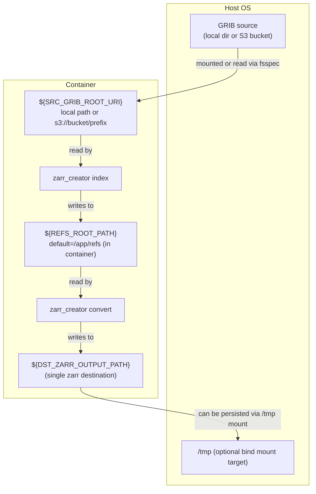
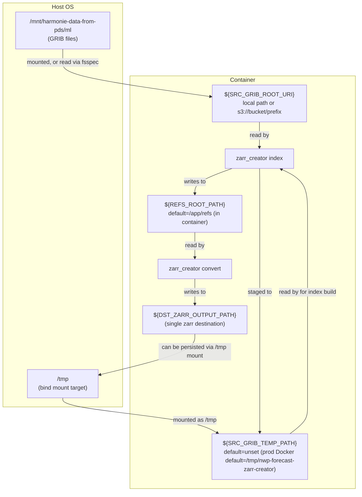

# NWP Forecast in zarr format

This repository contains the code to process DINI, IG and IFS GRIB files into zarr format.

For local VS Code + Docker development, see [DEVELOPING.md](DEVELOPING.md).

Currently, this writes all pressure-level fields to `pressure_levels.zarr`,
height-level fields to `height_levels.zarr` and everything else to
`single_levels.zarr`. We do not currently transfer and convert model-level
fields. These are written e.g. to

`s3://harmonie-zarr/dini/control/2025-03-03T060000Z/single_levels.zarr`

The general prefix format is:

`s3://harmonie-zarr/{suite_name}/{member}/{analysis_time}/{part_id}.zarr`


NB: note that for DINI we have fewer height-levels and so I have only included `50m`, `100m`, `150m` and `250m`. In addition a number of variables aren't in DINI or at least I don't understand what the variables that are there all mean. To see what is included please have a look at [zarr_creator/config.py](zarr_creator/config.py).


## Usage

### Periodic running

For continuous operation run the pipeline watcher, e.g. in a tmux session
(or as the container entrypoint, which does this by default):

```bash
uv run python -m zarr_creator run --watch
```

This polls for the latest analysis time every 5 minutes, builds
indexes/refs when missing, and converts to zarr (retrying on failure).
If not all source GRIB files for the analysis time have arrived yet, it logs
a warning and tries again on the next poll instead of exiting.
For a single analysis time (cron / Kubernetes Job), omit `--watch` and
optionally pass `--t-analysis`, an ISO8601 time with a timezone or `latest`
(the default: now minus `ANALYSIS_LAG_HOURS`, floored to a multiple of
`ANALYSIS_INTERVAL_HOURS`; with the defaults, now minus 2 hours floored to a
3-hour boundary, or 7 hours and 6 for the `ifs` suite). `--watch`
always follows the latest analysis time, so it cannot be combined with
`--t-analysis`. A one-shot run exits non-zero (e.g. when source files
are missing) so the scheduler can retry, and conversion failures retry
forever unless you pass `--max-retries N`:

```bash
uv run python -m zarr_creator run --t-analysis 2025-02-27T15:00:00Z
```

### Manually running

Running the conversion manually requires two steps:

1. Build GRIB indexes and refs:

```bash
uv run python -m zarr_creator index --t-analysis 2025-02-27T15:00:00Z
```

This writes refs to `refs/`. If you want to stage source GRIB files in a
temporary location before indexing (recommended for S3 sources), set
`SRC_GRIB_TEMP_PATH` as an environment variable.

2. Read the refs, build the three datasets (height-levels, pressure-levels and single-levels) as `xr.Datasets` and write each to the configured output:

```bash
uv run python -m zarr_creator convert --t-analysis 2025-02-27T15:00:00Z --suite-name dini
```

`--suite-name` can be set to `dini` (default), `ig` or `ifs` (see below).
Output destinations come from `DST_ZARR_OUTPUT_PATH` (default:
`file:///tmp/{suite_name}-recent/{dataset_id}.zarr`, i.e. local only).

### IFS (boundary input for ANNA)

The `ifs` suite converts ECMWF IFS control forecasts (formerly HRES) as
delivered to DMI's ECMWF cache on Scale (`/dmidata/cache/mdcprd/gdb/ecmwf/`,
files `dei_dj_ifs-ens-cf_od_oper_fc_<base>_<valid>_<step>h`, one per cycle
and step, 0.1° lat/lon). It writes a single `ifs.zarr` per cycle with:

- ERA5/WeatherBench2 variable names, as ANNA's boundary input uses
- dims `time` (analysis time), `prediction_timedelta`, `level` (hPa),
  `latitude` and `longitude`
- the native 0.1° grid (latitudes north to south) and all delivered pressure
  levels (50–1000 hPa, no 600 hPa), optionally clipped to a lat/lon box

There's no regridding. ANNA's boundary contract (a 0.25° ERA5 grid over lat
40.0–72.0, lon −27.0–39.5 with 8 levels including 600 hPa, see the header of
`src/anna_inference/boundary/ifs_7deg_model1_config.yaml` in
[dmidk/mlwp-inference-container-anna](https://github.com/dmidk/mlwp-inference-container-anna))
is left to ANNA's own pipeline, which regrids this output.

To keep the output small, clip it with `--clip-lat-min`, `--clip-lat-max`,
`--clip-lon-min` and `--clip-lon-max` (env `CLIP_LAT_MIN` etc.), in degrees
north and east, longitudes in −180..180. Each bound is optional and
inclusive, and one more grid point is kept beyond each one, so that a later
linear regrid onto points exactly on the edge interpolates rather than
extrapolates. The bounds are recorded as `clip_*` attributes of the zarr.
For ANNA's boundary box:

```bash
--clip-lat-min 40 --clip-lat-max 72 --clip-lon-min -27 --clip-lon-max 39.5
```

Clipping is only supported for `ifs`; the HARMONIE suites are on a projected
grid.

The suite changes some defaults:

- cycles are 6-hourly with a 7h delivery lag for `--t-analysis latest`
  (unless `ANALYSIS_INTERVAL_HOURS` / `ANALYSIS_LAG_HOURS` are set)
- steps go every 3h, up to `MAX_HOUR` (default 36, as for the other suites;
  see below for what ANNA needs)
- `MEMBER_ID` defaults to `control`
- the `.index` files are written to the refs directory, not next to the
  source files, since the ECMWF cache is shared

```bash
uv run python -m zarr_creator run --suite-name ifs \
    --src-grib-root-uri /dmidata/cache/mdcprd/gdb/ecmwf \
    --t-analysis 2026-09-28T00:00:00Z \
    --dst-zarr-output-path 'file:///tmp/{suite_name}/{t_analysis}/{dataset_id}.zarr'
```

The variable mapping (IFS shortName → output name) is in
`zarr_creator/config_ifs.py`. Two pressure-level fields aren't delivered as
ERA5 has them, so they are derived:

- `geopotential` = geopotential height `gh` × 9.80665 (exact)
- `specific_humidity` comes from relative humidity `r` and temperature `t`,
  using the IFS's mixed-phase saturation vapour pressure. That inverts how
  the IFS defines `r`, so it's close to exact.

#### How the IFS output lines up with DINI in ANNA

Each IFS cycle is converted on its own; nothing in this repo pairs IFS
cycles with DINI runs. ANNA does that when it builds its inference input
(`boundary_to_valid_time` in mlwp-inference-container-anna), after
regridding, and it can only use what this repo has written by then.

**In training** ANNA's interior was DANRA (3-hourly) and its boundary was
ERA5 reanalysis, 6-hourly at 00/06/12/18 UTC. For each predicted time `t`,
neural-lam takes the boundary at `b`, the last 6-hourly time at or before
`t`, plus `b − 6h` and `b + 6h`. So the boundary was always an analysis
valid at exactly those times, with no forecast lead, and it included the
"truth" 6h ahead. IFS forecasts were only used to evaluate the model, not to
train it.

**In operations** the interior is a DINI run (3-hourly cycles). ANNA takes
the latest IFS cycle at or before the DINI analysis time, turns each lead
time into a valid time (cycle + `prediction_timedelta`) and then picks the
same 6-hourly windows as in training. The layout is therefore what the model
was trained on, but the values are forecasts, and their lead time grows with
how old the IFS cycle is and how far ahead ANNA forecasts.

Example, a DINI 03Z run with ANNA's default 18h forecast: ANNA predicts 09Z
to 21Z, so it needs the boundary valid at 00Z, 06Z, 12Z, 18Z and 00Z the
next day.

| IFS cycle used | Lead times needed |
|---|---|
| 00Z the same day, if it has arrived | 0–24h |
| 18Z the day before (the 00Z cycle isn't in yet, with the 7h lag) | 6–30h |

In general the longest lead time needed is the time from the IFS cycle to
6h after the last 00/06/12/18 UTC time at or before the end of the ANNA
forecast. With the 6h cycle and 7h lag the newest IFS cycle is 6–9h older
than the DINI run, so:

- the default `MAX_HOUR=36` covers ANNA's default 18h forecast (up to 30h
  needed)
- ANNA's longest forecast, 30h, needs up to 42h, so set `MAX_HOUR=42` or more
- if an IFS cycle is late or missing, an older one has to be used, which
  needs correspondingly longer lead times (6h more per cycle skipped)

Where the IFS boundary still differs from training:

- it is a forecast, not a reanalysis, and is normalised with the ERA5
  training statistics
- `geopotential` and `specific_humidity` are derived here (see above), and
  ANNA's pipeline regrids to 0.25° and interpolates the 600 hPa level
- the static fields (`land_sea_mask`, `geopotential_at_surface`) come from
  IFS, not ERA5

ANNA can also use DINI itself as the boundary (its current default), but
that only works for 00/06/12/18Z runs and a quarter of the boundary points
lie outside DINI and are filled from the nearest DINI edge point. IFS covers
the whole boundary and also works for the 03/09/15/21Z DINI runs.

## Runtime Defaults

Shared runtime defaults are defined in `zarr_creator/settings.py` (one module
per setting, each mapped 1:1 to an environment variable).

**Configuration precedence: CLI flag > environment variable > built-in
default.** The container is configured purely via environment (its
entrypoint takes no config args); flags are manual overrides. For example,
`--max-hour 12` beats `MAX_HOUR=12`, which beats the built-in `36`.

You can override any default by exporting the corresponding environment variable
before running, or by passing the corresponding CLI flag (e.g.
`--max-hour`, `--src-grib-root-uri`, `--dst-zarr-output-path`).

| Variable | Built-in default | Default in container | Meaning |
|---|---|---|---|
| `SRC_GRIB_ROOT_URI` | `/mnt/harmonie-data-from-pds/ml` | *as built-in default* | Root URI that GRIB forecast files resolve relative to; a local path or `s3://bucket/prefix`. (`SRC_GRIB_ROOT` / `SRC_GRIB_ROOT_PATH` still work as deprecated aliases.) |
| `REFS_ROOT_PATH` | `/home/ec2-user/nwp-forecast-zarr-creator/refs` | `/app/refs` | Directory where gribscan refs are written (always local). Once an analysis time has been converted its refs are deleted, leaving only a `.done` marker so it is not processed again (pass `--no-cleanup` to keep them). |
| `SRC_GRIB_TEMP_PATH` | _unset_ | `/tmp/nwp-forecast-zarr-creator` | If set, GRIB files are staged here before indexing. If unset, files are indexed in place from `SRC_GRIB_ROOT_URI` (S3 sources without a staging path log a warning). |
| `DST_ZARR_OUTPUT_PATH` | `file:///tmp/{suite_name}-recent/{dataset_id}.zarr` | `s3://harmonie-zarr/{suite_name}/{member}/{t_analysis}/{dataset_id}.zarr` | Full output-path format string (`{suite_name}`, `{member}`, `{t_analysis}`, `{dataset_id}`), written via fsspec (local path or `s3://`). Must contain `{dataset_id}`; without `{t_analysis}` each run overwrites the previous output. |
| `MEMBER_ID` | `CONTROL__dmi` (`control` for `ifs`) | *as built-in default* | Forecast member identifier in file names (IFS file names have none; it's only used in the refs path). |
| `MAX_HOUR` | `36` | *as built-in default* | Maximum forecast hour included (inclusive, `000..MAX_HOUR`; every 3h for `ifs`). |
| `SUITE_NAME` | `dini` | *unset (uses default)* | Defines the config file to use for converting GRIB files. Valid options are `dini`, `ig` and `ifs`. |
| `SRC_AWS_PROFILE` / `DST_AWS_PROFILE` | _unset_ | _unset_ | AWS profile for source reads / destination writes, each falling back to `AWS_PROFILE`. Endpoint, keys, and region resolve from `~/.aws` via the named profile. |
| `SRC_ANON` | _unset_ | _unset_ | Set to `1` for unsigned S3 source reads (public fixture bucket). |
| `S3_VERIFY_SSL` | _unset_ (verify) | _unset_ (verify) | Set to `0` to skip TLS certificate verification for all S3 reads and writes, like `aws s3 --no-verify-ssl` (e.g. for an endpoint signed by an internal CA). |
| `ANALYSIS_INTERVAL_HOURS` | `3` (`6` for `ifs`) | *as built-in default* | Hours between analysis times; `latest` and `--watch` floor to a multiple of this. Must divide 24 (e.g. `1` for hourly analyses). |
| `ANALYSIS_LAG_HOURS` | `2` (`7` for `ifs`) | *as built-in default* | Hours allowed for source data delivery; `latest` means now minus this, floored to the analysis interval. |
| `CLIP_LAT_MIN` / `CLIP_LAT_MAX` / `CLIP_LON_MIN` / `CLIP_LON_MAX` | _unset_ (no clipping) | _unset_ | `ifs` only: clip the output to this lat/lon box (degrees, inclusive, longitudes in −180..180), keeping one grid point beyond each bound. Each bound is optional. |

For the dev container (`docker-compose.dev.yml`), `SRC_GRIB_TEMP_PATH` is
unset.

Example overrides:

```bash
export MAX_HOUR=12
export SRC_GRIB_TEMP_PATH=/tmp/nwp-forecast-zarr-creator
uv run python -m zarr_creator index --t-analysis 2025-02-27T15:00:00Z
```

Data flow when `SRC_GRIB_TEMP_PATH` is **unset** (index in place):



Data flow when `SRC_GRIB_TEMP_PATH` is **set** (stage-before-indexing):



### Intake Catalog Usage

There are two ways to easily read the converted zarr datasets easily from AWS S3
using the intake catalog in this repo. Either by reading the intake catalog directly from github, or by installing the `zarr_creator` package and using the `open_intake_catalog()`.

#### 1. Open the catalog directly from GitHub

```python
import intake
import isodate

analysis_time = isodate.parse_datetime("2026-02-16T00:00:00Z")
catalog = intake.open_catalog(
    "https://raw.githubusercontent.com/dmidk/nwp-forecast-zarr-creator/main/zarr_creator/catalog/catalog.yml"
)
ds_dini_hl = catalog["height_levels"]._entry(analysis_time=analysis_time).to_dask()
```

#### 2. Open the packaged catalog with `open_intake_catalog()`

```python
import isodate

from zarr_creator import open_intake_catalog

analysis_time = isodate.parse_datetime("2026-02-16T00:00:00Z")
catalog = open_intake_catalog()
ds_dini_hl = catalog["height_levels"]._entry(analysis_time=analysis_time).to_dask()
```

# Implementation notes

- GRIB indexes and refs are built by calling gribscan directly (rather than
  using the DMI "data-catalog" python package `dmidc`), because DINI uses
  special paramIds for e.g. u-wind at 10m and 100m that differ from the
  general u-wind parameter IDs, which made data-catalog cumbersome. Calling
  gribscan directly also makes the mapping of variables by level-type into
  `height_levels.zarr`, `pressure_levels.zarr` and `single_levels.zarr` more
  explicit.
- S3 is accessed via `fsspec`'s `s3` protocol implementation, not via s3fs
  (FUSE) mounts.


# Running with Docker

To enable running on AWS EC2 in Amazon Linux 2 we provide a Dockerfile. This was because:

- python `eccodes<2.43.0` requires system install of the ecCodes C library
  (`eccodes>=2.37.0,<2.43.0` wheels should include the C library, but they
  don’t)
  - system eccodes (`2.30.0`) C library was unstable and crashed frequently when
    used with `<2.43.0` python lib.
  - Compiling a newer ecCodes manually failed because it requires `cmake>3.12`,
    which Amazon Linux 2 doesn’t provide.
- python `eccodes>=2.43.0`: switched to `eccodeslib` python for C bindings, but
  no wheels exist for `eccodeslib` for Amazon Linux.

So we run everything inside a container with a known-good ecCodes installation,
so we have a consistent and reproducible environment.


Build image (using most recent git tag to set tag for image):

```bash
docker build -t nwp-forecast-zarr-creator:$(git describe --tags --abbrev=0) .
```

Run container (by default the image runs the pipeline watcher, i.e. `run --watch`):

```bash
docker run --rm -it -v /mnt/:/mnt/ -v /tmp/:/tmp/ --name nwp-forecast-zarr-creator nwp-forecast-zarr-creator:$(git describe --tags --abbrev=0)
```

Arguments after the image name replace the default `--watch`, so to process a
single analysis time and exit (cron / Kubernetes Job) pass `--t-analysis`
(omit it to use the latest complete analysis time):

```bash
docker run --rm -it -v /mnt/:/mnt/ -v /tmp/:/tmp/ nwp-forecast-zarr-creator:$(git describe --tags --abbrev=0) --t-analysis 2025-02-27T15:00:00Z
```

Configuration is purely via environment variables (see Runtime Defaults
above), e.g. `-e SRC_GRIB_ROOT_URI=s3://my-bucket/ml -e
DST_ZARR_OUTPUT_PATH=s3://my-out/{suite_name}/{member}/{t_analysis}/{dataset_id}.zarr`.

In the production Docker image, `SRC_GRIB_TEMP_PATH` is set by default to
`/tmp/nwp-forecast-zarr-creator`, so GRIB files are staged before indexing
unless you override `SRC_GRIB_TEMP_PATH`, and `DST_ZARR_OUTPUT_PATH`
defaults to the timestamped `s3://harmonie-zarr/...` layout.

Regarding the volume mounts:
- If source GRIBs live on the host filesystem, mount them (e.g. `-v /mnt/:/mnt/`)
  and point `SRC_GRIB_ROOT_URI` at the mount. Alternatively set
  `SRC_GRIB_ROOT_URI=s3://bucket/prefix` to read directly from object
  storage (credentials via `SRC_AWS_PROFILE` / `~/.aws`, no s3fs mount needed).
- By mounting the `/tmp` path to the system one we avoid having to copy the
  files on every execution by using the system storage as a cache.

## Published container images

CI (`.github/workflows/container-image.yml`) builds the image on every push and
pull request to check that it still builds, but does not publish it. Images are
only published to `ghcr.io/dmidk/nwp-forecast-zarr-creator` when a version tag
(`v*`) is pushed, and are tagged with the version and `latest`:

```bash
docker pull ghcr.io/dmidk/nwp-forecast-zarr-creator:v0.9.0
```

To publish a new image, make a release, see
[Making a release](DEVELOPING.md#making-a-release).
